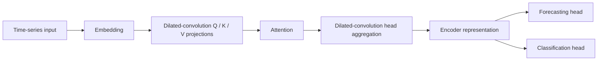

# DC-MSA: A Novel Low-Complexity Dilated Convolutions-Based Multi-Head Self-Attention for Time-Series Analysis-Based Transformers

<p align="center">
  
  
  
</p>

Research code accompanying **DC-MSA**, a dilated-convolution-based multi-head self-attention approach for time-series Transformers.

**Manuscript status:** Submitted to [Machine Learning with Applications](https://www.sciencedirect.com/journal/machine-learning-with-applications).

[Overview](#overview) ? [Installation](#installation) ? [Datasets](#datasets) ? [Getting started](#getting-started) ? [Reproducibility](#reproducibility) ? [Acknowledgments](#acknowledgments)

## Overview

DC-MSA investigates dilated convolutions for attention projections and head aggregation in time-series Transformers, with an emphasis on computational efficiency. This repository contains experiments for multivariate time-series forecasting and classification, together with baseline models and utilities for evaluating prediction quality, parameter counts, and computational cost.

The implementation includes:

- Dilated convolution operations for query, key, and value projections and head aggregation.
- Training and evaluation pipelines for forecasting and classification.
- Forecasting metrics, classification metrics, and profiling with THOP and fvcore.
- Dataset loaders, experiment scripts, and prediction-analysis notebooks.

The diagram summarizes the convolution-based encoder path; see the source for exact tensor operations.



## Installation

Use Linux or WSL/Ubuntu for the supplied Bash scripts. Run commands from the directory containing `run.py`?the local research workspace calls this directory `Project/`.

The dependency versions in [requirements.txt](requirements.txt) were taken from the local research environment. Entry-point imports and small model forward passes were checked with **Python 3.14.4** and **PyTorch 2.12.0+cu126**. These checks do not establish a clean-install environment or reproduce the paper's experiments.

```bash
python3.14 -m venv .venv
source .venv/bin/activate
python -m pip install --upgrade pip
```

Install a **PyTorch 2.12.0** build appropriate for your hardware using the [official PyTorch installation instructions](https://pytorch.org/get-started/locally/), then install the remaining dependencies:

```bash
python -m pip install -r requirements.txt
python -m pip check
python run.py --help
```

The singular filename `requirement.txt` is also supported and forwards to `requirements.txt`. The requirements cover the training and evaluation code; notebook-specific tools may need separate installation.

**GPU:** The current evaluation routines use CUDA synchronization for inference-time measurements. Use a CUDA-capable GPU for the complete training/evaluation examples. CPU model forward passes work, but full CPU evaluation requires adapting the timing routines.

## Datasets

### Forecasting

For forecasting benchmark background and data preparation, refer to the [Informer paper](https://arxiv.org/abs/2012.07436), **Informer: Beyond Efficient Transformer for Long Sequence Time-Series Forecasting**, and its [official repository and data instructions](https://github.com/zhouhaoyi/Informer2020#data).

| Dataset | Source | Expected location |
| --- | --- | --- |
| ETT: ETTh1, ETTh2, ETTm1, ETTm2 | [ETDataset](https://github.com/zhouhaoyi/ETDataset) | `dataset/ETT-small/` |
| Electricity | [Informer data resources](https://github.com/zhouhaoyi/Informer2020#data); [TSLib benchmark preparation](https://github.com/thuml/Time-Series-Library#usage) | `dataset/electricity/electricity.csv` |
| Weather | [Informer data resources](https://github.com/zhouhaoyi/Informer2020#data); [TSLib benchmark preparation](https://github.com/thuml/Time-Series-Library#usage) | `dataset/weather/weather.csv` |
| Exchange rate | [TSLib benchmark preparation](https://github.com/thuml/Time-Series-Library#usage) | `dataset/exchange_rate/exchange_rate.csv` |

These datasets are referenced by the supplied convolution experiment scripts. Informer provides the ETT, electricity, and weather resources; the exchange-rate benchmark is linked separately through TSLib. Select the preprocessed CSV files matching the experiment configuration, as similarly named datasets from different sources may have different columns and sampling intervals.

Use `--data ETTh1`, `ETTh2`, `ETTm1`, or `ETTm2` for the dedicated ETT loaders. Use `--data custom` for electricity, weather, and exchange-rate CSVs. Match `--enc_in`, `--dec_in`, and `--c_out` to the data dimensions; set `--freq` to the sampling frequency.

### Classification

Classification datasets are provided by the **UEA Multivariate Time Series Classification Archive**:

- [Official UEA/UCR dataset portal](https://www.timeseriesclassification.com/dataset.php)
- [UEA multivariate archive in .ts format](https://www.timeseriesclassification.com/aeon-toolkit/Archives/Multivariate2018_ts.zip)

The supplied classification scripts reference **FaceDetection, Handwriting, Heartbeat, JapaneseVowels, SpokenArabicDigits, and UWaveGestureLibrary**.

Extract each dataset into its own directory and preserve the original training and test filenames:

```text
dataset/
??? ETT-small/
?   ??? ETTh1.csv
?   ??? ETTh2.csv
?   ??? ETTm1.csv
?   ??? ETTm2.csv
??? electricity/
?   ??? electricity.csv
??? exchange_rate/
?   ??? exchange_rate.csv
??? weather/
?   ??? weather.csv
??? FaceDetection/
    ??? FaceDetection_TRAIN.ts
    ??? FaceDetection_TEST.ts
```

For classification, `--model_id` must match the dataset name, such as `FaceDetection`. The loader checks for local `.ts` files first and otherwise attempts a download from the `thuml/Time-Series-Library` dataset repository on Hugging Face.

Datasets are downloaded separately and are excluded from the source repository.

## Getting started

These examples exercise the current source implementation. They are starting configurations, not a claim of reproducing the submitted paper's final tables.

**Current convolution settings:** Use `--d_model 512 --n_heads 8` for these examples. The convolution kernel size, dilation, and output channels are currently fixed in [layers/SelfAttention_Family.py](layers/SelfAttention_Family.py). Older scripts using `d_model=128` are incompatible with those settings.

### Forecasting example: ETTh1

After downloading `dataset/ETT-small/ETTh1.csv`:

```bash
CUDA_VISIBLE_DEVICES=0 python -u run.py \
  --task_name long_term_forecast \
  --is_training 1 \
  --model_id ETTh1_96_96 \
  --model iTransformerConv \
  --data ETTh1 \
  --root_path ./dataset/ETT-small/ \
  --data_path ETTh1.csv \
  --features M --target OT --freq h \
  --seq_len 96 --label_len 48 --pred_len 96 \
  --enc_in 7 --dec_in 7 --c_out 7 \
  --d_model 512 --n_heads 8 --e_layers 2 --d_ff 2048 \
  --batch_size 32 --learning_rate 0.0001 \
  --train_epochs 5 --patience 3 --num_workers 0 \
  --des demo --itr 1
```

The training entry point evaluates the trained model automatically. Change `--pred_len` to select a different forecast horizon and use a distinct `--model_id` for each experiment.

### Classification example: FaceDetection

After extracting the `.ts` files:

```bash
CUDA_VISIBLE_DEVICES=0 python -u run.py \
  --task_name classification \
  --is_training 1 \
  --model_id FaceDetection \
  --model TransformerEncoderConv \
  --data UEA \
  --root_path ./dataset/FaceDetection/ \
  --d_model 512 --n_heads 8 --e_layers 3 --d_ff 256 \
  --batch_size 16 --learning_rate 0.001 \
  --train_epochs 100 --patience 10 --num_workers 0 \
  --des demo --itr 1
```

The classification pipeline infers the number of input channels, sequence length, and number of classes from the data.

**Evaluation protocol:** The current classification training loop uses the `TEST` split for validation and early stopping as well as final evaluation. Its reported scores therefore involve test-set model selection. Establish a validation split from the training data before using this pipeline for an independent held-out benchmark.

### Experiment scripts and outputs

Forecasting scripts are available in [Dilated_ConvExps/](Dilated_ConvExps/); classification scripts are in [ClassificationScripts/](ClassificationScripts/). Some files end in `.sh_`; these remain Bash scripts. Review their GPU selection and model dimensions before running a batch of experiments.

| Task | Output locations, relative to the project root |
| --- | --- |
| Forecasting | `<model>/<dataset>/checkpoints/`, `results/`, and `test_results/` |
| Classification | `<dataset>/<model>/checkpoints/` and `test_results/` |

Forecasting results include `pred.npy`, `true.npy`, and `metrics.npy`. Classification results include class probabilities, predictions, labels, and a text summary. Training losses are saved under each checkpoint's `loss_recordings/` directory.

## Repository structure

```text
.
??? run.py                    # Experiment entry point
??? model/                    # Model implementations
??? layers/                   # Attention, embedding, and encoder components
??? experiments/              # Training and evaluation loops
??? data_provider/            # Forecasting and UEA data loaders
??? utils/                    # Metrics, preprocessing, and training utilities
??? Dilated_ConvExps/          # Forecasting experiment scripts
??? ClassificationScripts/    # Classification experiment scripts
??? docs/                     # Release preparation and verification notes
??? dataset/                  # Downloaded locally; excluded from Git
??? requirements.txt          # Runtime dependencies
??? requirement.txt           # Alias for requirements.txt
```

## Reproducibility

- `run.py` seeds Python, NumPy, and PyTorch with **2023**. Repeated runs use that same seed; deterministic GPU behavior is not explicitly enforced.
- Preserve the dataset version, preprocessing, train/validation/test protocol, model configuration, and hardware details when comparing results.
- The current command dispatcher supports `long_term_forecast` and `classification`; other task names shown in argument help are not wired into the entry point.
- Parameter counts, MACs, FLOPs, and measured latency describe different aspects of efficiency. Compare them under the same input dimensions, batch size, hardware, and profiling convention.
- Dependency checks and synthetic forward passes have been performed. Full training and paper-result reproduction have not been rerun as part of this documentation update.

See [release preparation notes](docs/RELEASE_PREPARATION.md) for the verification scope and implementation issues identified during documentation.

## Acknowledgments

We gratefully acknowledge the authors and contributors of the following projects for their publicly available implementations, experiment infrastructure, and dataset resources:

- **[iTransformer](https://github.com/thuml/iTransformer)** ? inverted Transformer implementations and time-series forecasting infrastructure.
- **[Time-Series-Library (TSLib)](https://github.com/thuml/Time-Series-Library)** ? time-series models, data loaders, and forecasting/classification experiment pipelines.
- **[Informer](https://github.com/zhouhaoyi/Informer2020)** ? forecasting benchmark resources and data-preparation guidance.
- **[UEA Time Series Classification Archive](https://www.timeseriesclassification.com/)** ? multivariate time-series classification datasets.

Please also acknowledge the original publications and dataset creators when using their code or data.
